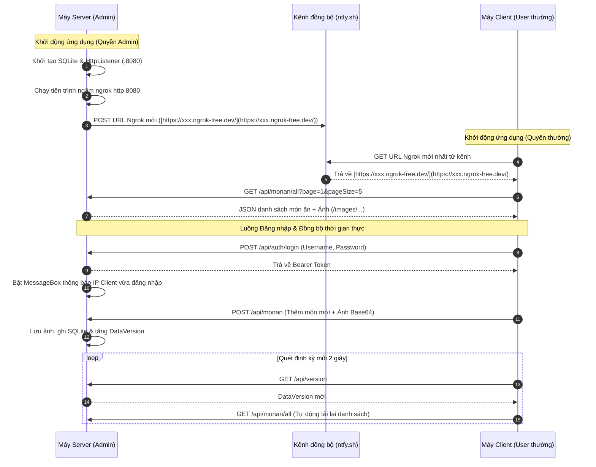

<h1 align="center">🖥️ LAB 4 – WORKING WITH WEB SERVER IN C#</h1>
<div align="center">

### TRUYỀN THÔNG VỚI WEB SERVER TRONG C#

*Bài thực hành nhóm môn Lập trình mạng căn bản – Xây dựng ứng dụng giao tiếp với Web Server, xử lý HTTP Request/Response, khai thác dữ liệu website và tích hợp Web API bằng C#.*

<a href ="https://learn.microsoft.com/vi-vn/dotnet/csharp/" target="_blank" rel="noopener noreferrer">
    
  </a>
   <a href ="https://dotnet.microsoft.com/" target="_blank" rel="noopener noreferrer">
     
  </a>
  <a href ="https://learn.microsoft.com/vi-vn/dotnet/desktop/winforms/" target="_blank" rel="noopener noreferrer">
     
  </a>
  <a href="https://www.w3schools.com/tags/ref_httpmethods.asp" target="_blank" rel="noopener noreferrer">
    
  </a>
  <a href="https://viblo.asia/p/html5-overview-jlA7GKByMKZQ" target="_blank" rel="noopener noreferrer">
    
  </a>
  <a href="https://www.json.org/json-en.html" target="_blank" rel="noopener noreferrer">
    
  </a>
  <a href="https://developer.microsoft.com/vi-vn/microsoft-edge/webview2?form=MA13LH&cs=1190118532"target="_blank" rel="noopener noreferrer">
    
  </a>
  <a href="https://blog-postman-com.translate.goog/rest-api-examples/?_x_tr_sl=en&_x_tr_tl=vi&_x_tr_hl=vi&_x_tr_pto=tc" target="_blank" rel="noopener noreferrer">
    
  </a>
  <a href ="https://git-scm.com/" target="_blank" rel="noopener noreferrer">
     
  </a>
  <a href ="https://github.com/hongmynhu18years-svg/LAB03_NT106" target="_blank" rel="noopener noreferrer">
     
  </a>
  
</div>

---

## 👥 Thông tin nhóm thực hiện

| Nội dung | Thông tin |
|---|---|
| **Môn học** | Lập trình mạng căn bản |
| **Bài thực hành** | Lab 4 – Working with Web Server in C# |
| **Nhóm** | 3 |
| **Lớp** | NT106.R14.2 |

## 🧑‍💻 Danh sách thành viên

| STT | Họ và tên | MSSV | 
|:---:|---|:---:|
| 1 | Hồng Mỹ Như | 25521342 | 
| 2 | Tô Thị Thanh Nhi | 25521332 | 
| 3 | Trương Vũ Hoàng Ngân | 25521185 | 
| 4 | Võ Thị Minh Thư | 25521816 |
| 5 | Lê Hoàn Phúc | 25521422 |

---

## 📖 Giới thiệu

**LAB 4 – Working with Web Server in C#** là bài thực hành nhóm thuộc môn **Lập trình mạng căn bản**, tập trung xây dựng các ứng dụng giao tiếp với Web Server bằng ngôn ngữ C# trên nền tảng Windows Forms.

Bài thực hành giúp sinh viên tìm hiểu cơ chế **HTTP Request/Response**, sử dụng các phương thức **GET, POST** để gửi và nhận dữ liệu, tải nội dung website, xử lý HTML và JSON, đồng thời khai thác Web API để xây dựng các ứng dụng thực tế.

Ngoài ra, Lab 04 giới thiệu cách tạo website đơn giản bằng **HTML**, triển khai Web Server cục bộ bằng **IIS (localhost)** và sử dụng **Postman** để kiểm tra API.

Các bài tập được tổ chức thành những project riêng trong cùng một solution, kết hợp giao diện Windows Forms để thực hiện các chức năng tương ứng.

<p align="center">


</p>

### 🎯 Mục tiêu thực hành

- Hiểu nguyên lý giao tiếp giữa Client và Web Server thông qua HTTP/HTTPS.
- Sử dụng `WebRequest`, `WebResponse`, `WebClient` và `HttpClient` để gửi, nhận dữ liệu.
- Thực hiện HTTP GET và POST để truy xuất thông tin và gửi dữ liệu lên Web Server.
- Xây dựng website HTML đơn giản và triển khai trên localhost bằng IIS.
- Sử dụng `WebView2` để hiển thị website trong ứng dụng Windows Forms.
- Tải nội dung HTML, trích xuất dữ liệu và tài nguyên website.
- Xử lý dữ liệu **JSON** và khai thác **REST API**.
- Tìm hiểu cơ chế xác thực bằng **JWT (JSON Web Token)**.
- Kết hợp API để xây dựng các ứng dụng quản lý và xử lý dữ liệu thực tế.
- Sử dụng **Postman** để kiểm tra các yêu cầu HTTP và phản hồi từ API.

### 📚 Nội dung thực hành

| Bài | Tên bài thực hành | Mô hình / Công nghệ |
|---|---|---|
| **01** | Hiển thị mã nguồn HTML của website | HTTP GET, `WebRequest`, `WebResponse` |
| **02** | Download nội dung website thành file HTML | `WebClient`, `DownloadFile()` |
| **03** | Xây dựng trình duyệt Web cơ bản | `WebView2`, HTML Agility Pack |
| **04** | Quản lý phòng vé – Phiên bản 4 | Web Scraping, JSON, Windows Forms |
| **07** | Hôm nay ăn gì? – Phiên bản 4 | REST API, quản lý và chọn ngẫu nhiên món ăn |

### 🛠️ Công nghệ sử dụng

- **Ngôn ngữ lập trình:** C#
- **Nền tảng:** .NET, Windows Forms
- **IDE:** Microsoft Visual Studio
- **Giao thức:** HTTP/HTTPS
- **Web Server:** IIS, localhost
- **Thư viện:** `System.Net`, `System.IO`, `System.Net.Http`
- **Web Browser:** Microsoft Edge WebView2
- **Xử lý HTML:** HTML Agility Pack
- **Định dạng dữ liệu:** HTML, JSON
- **Quản lý mã nguồn:** Git, GitHub

---

## 📄 BÀI 1 – HIỂN THỊ MÃ NGUỒN HTML (VIEW HTML SOURCE)

### 🖼️ Giao diện chương trình

**Giao diện View HTML Source**

<p align="center">


   
</p>

### 🎯 Nội dung thực hành

- Xây dựng ứng dụng **C# Windows Forms** để lấy và hiển thị mã nguồn HTML của website.
- Sử dụng **HTTP/HTTPS** và phương thức **GET** để giao tiếp với Web Server.
- Sử dụng `WebRequest`, `WebResponse`, `Stream` và `StreamReader` để gửi yêu cầu, nhận và đọc dữ liệu.
- Kiểm tra tính hợp lệ của URL và xử lý lỗi kết nối.
- Hiển thị HTML trong `RichTextBox`, hỗ trợ tự động xuống dòng và thanh cuộn dọc.

### 🛠️ Cách thức thực hiện

**1. Khởi tạo giao diện (`Bai01Form`)**

- Khởi tạo Windows Forms bằng `InitializeComponent()`.
- Sử dụng `txtURL` để nhập địa chỉ website.
- Sử dụng `btnGET` để thực hiện yêu cầu lấy HTML.
- Sử dụng `rtbHTML` để hiển thị nội dung nhận được.
- Thiết lập `WordWrap = true`, `ScrollBars = Vertical` và `ReadOnly = true` cho `rtbHTML`.

**2. Xử lý sự kiện GET (`btnGET_Click()`)**

- Khi người dùng nhấn **GET**, sự kiện `btnGET_Click()` được kích hoạt.
- Lấy URL bằng `txtURL.Text.Trim()`.
- Kiểm tra URL rỗng bằng `string.IsNullOrEmpty()`.
- Kiểm tra định dạng URL bằng `Uri.TryCreate()` và giao thức bằng `uri.Scheme`.
- Chỉ chấp nhận URL sử dụng **HTTP/HTTPS**.
- Nếu hợp lệ, gọi hàm `getHTML(url)` để lấy dữ liệu.
- Xóa nội dung cũ và hiển thị HTML mới trong `rtbHTML`.

**3. Gửi yêu cầu HTTP GET (`getHTML()`)**

- Sử dụng `WebRequest.Create(szURL)` để khởi tạo HTTP Request.
- Thiết lập `request.Timeout = 10000` để giới hạn thời gian chờ 10 giây.
- Gọi `GetResponse()` để nhận phản hồi từ Web Server.
- Sử dụng `GetResponseStream()` để lấy luồng dữ liệu.
- Sử dụng `StreamReader.ReadToEnd()` để đọc toàn bộ HTML thành chuỗi.
- Sử dụng `using` để tự động giải phóng tài nguyên sau khi xử lý.

**4. Hiển thị kết quả và xử lý lỗi**

- Gán nội dung HTML bằng `rtbHTML.Text = html`.
- Sử dụng `SelectionStart = 0` và `ScrollToCaret()` để đưa nội dung về đầu.
- Hỗ trợ xuống dòng tự động và thanh cuộn dọc.
- Sử dụng `try-catch` để xử lý các lỗi phát sinh.
- Sử dụng `WebException` để bắt lỗi liên quan đến kết nối Web Server.
- Hiển thị thông báo lỗi bằng `MessageBox.Show()`.

### 📡 Giao thức trao đổi dữ liệu

| Thành phần | Chức năng |
|---|---|
| `HTTP GET` | Yêu cầu lấy nội dung website |
| `WebRequest` | Tạo và gửi HTTP Request |
| `WebResponse` | Nhận HTTP Response |
| `StreamReader` | Đọc dữ liệu HTML |
| `RichTextBox` | Hiển thị mã nguồn HTML |

**Quy trình xử lý:**

1. Người dùng nhập URL và nhấn **GET**.
2. Chương trình kiểm tra tính hợp lệ của URL.
3. Client gửi HTTP GET Request đến Web Server.
4. Web Server xử lý yêu cầu và trả về HTTP Response.
5. Client sử dụng `StreamReader` để đọc nội dung HTML.
6. Hiển thị mã nguồn HTML lên `rtbHTML`.

**Sơ đồ hoạt động:**

```text
Người dùng
    |
    v
Nhập URL (txtURL)
    |
    v
Nhấn GET (btnGET_Click)
    |
    v
Kiểm tra URL hợp lệ
    |
    v
WebRequest -> Web Server
    |
    v
WebResponse -> StreamReader
    |
    v
Hiển thị HTML (rtbHTML)
```

### ▶️ Hướng dẫn sử dụng

1. Mở solution `Lab04` bằng Microsoft Visual Studio.
2. Chọn project `Bai01` làm **Startup Project**.
3. Nhấn `Ctrl + Shift + B` để Build Solution.
4. Nhấn `F5` để chạy chương trình.
5. Nhập URL, ví dụ `https://example.com`.
6. Nhấn **GET** để lấy nội dung HTML.
7. Xem mã nguồn trong `rtbHTML` và cuộn dọc khi cần.
8. Nhập URL mới và nhấn GET để cập nhật nội dung.

> [!NOTE]
> Chương trình hiển thị mã nguồn HTML dưới dạng văn bản, không render thành giao diện website.

---

# 🍱Bài 7: Hôm Nay Ăn Gì? 

Ứng dụng desktop Windows Forms (C# / .NET) quản lý, đóng góp và gợi ý món ăn ngẫu nhiên theo mô hình **Client – Server phân tán qua Internet**, tích hợp RESTful API Server nhúng (`HttpListener`), cơ sở dữ liệu **SQLite**, đường hầm công khai **Ngrok** và kênh đồng bộ địa chỉ tự động **ntfy.sh**.

---

## 1. Giao diện chương trình

Ứng dụng được thiết kế theo phong cách minh họa ấm áp với 4 màn hình chức năng chính:

* **Màn hình chính (`HomNayAnGi`):**
  * **Khu vực trên:** Tiêu đề *HÔM NAY ĂN GÌ?*, nút chọn món ngẫu nhiên (**Ăn gì giờ?**) và nút mở form thêm món (**Thêm món ăn**).
  * **Khu vực giữa (`TabControl`):** Chia thành 2 tab **All** (toàn bộ món ăn trong hệ thống) và **Tôi đóng góp** (danh sách món ăn do tài khoản đang đăng nhập thêm vào). Mỗi món được hiển thị dưới dạng thẻ `MonAnCard` gồm hình ảnh, tên món, giá tiền, người đóng góp và nút **Xoá**.
  * **Khu vực dưới:** Liên kết **Login / Logout**, nhãn trạng thái xác thực (`Unauthenticated` hoặc `Welcome, <Tên>`), thanh tiến trình tải dữ liệu và hộp chọn số trang (**Page**).
<p align="center">

</p>
* **Màn hình Đăng nhập (`LoginForm`):** Nhập `Username`, `Password`, hộp kiểm *Hiện mật khẩu*, nút **Login** và liên kết **Sign up** để chuyển sang giao diện đăng ký.
<p align="center">

</p>
* **Màn hình Đăng ký tài khoản (`SignupForm`):** Nhập thông tin tài khoản (`Username`, `Password`) và thông tin cá nhân (`First name`, `Last name`, `Email`, `Phone`, `Birth`, `Languages`, `Sex`) kèm nút **Clear** và **Submit**.
<p align="center">

</p>
* **Màn hình Món ăn ngẫu nhiên (`RandomMonAn`):** Cửa sổ bật lên hiển thị tên món ăn được hệ thống chọn ngẫu nhiên (ví dụ: *Ăn Hủ tiếu đi!!!!*) cùng hình ảnh minh họa của món đó.
<p align="center">

</p>

---

## 2. Nội dung thực hành

* **Xây dựng ứng dụng mạng theo kiến trúc Client – Server:** Tách biệt hoàn toàn tầng giao diện người dùng (WinForms Client) và tầng xử lý nghiệp vụ, lưu trữ dữ liệu (Embedded RESTful API Server + SQLite).
* **Lập trình giao tiếp HTTP & RESTful API:** Sử dụng `HttpListener` ở phía Server và `HttpClient` ở phía Client để trao đổi dữ liệu định dạng **JSON** qua các phương thức `GET`, `POST`, `DELETE`.
* **Xác thực & Phân quyền người dùng:** Cài đặt cơ chế băm mật khẩu bằng **SHA-256**, cấp phát và kiểm tra phiên làm việc bằng **Bearer Token** trong HTTP Header.
* **Triển khai đường hầm công khai & Đồng bộ động:** Kết hợp `ngrok` để mở cổng dịch vụ `localhost:8080` ra Internet và sử dụng dịch vụ `ntfy.sh` làm kênh báo hiệu (signaling) giúp các máy Client tự động tìm thấy Server mới mà không cần IP tĩnh.
* **Cập nhật dữ liệu thời gian thực (Real-time Sync):** Sử dụng cơ chế đánh dấu phiên bản dữ liệu (`DataVersion`) và bộ định thời (`Timer`) quét mỗi 2 giây để tự động làm mới giao diện giữa các máy.

---

## 3. Cách thức thực hiện

### 3.1. Cài đặt Ngrok (Thực hiện trên máy sẽ đóng vai trò Server)

Mở **Command Prompt (CMD)** và chạy các lệnh sau:

```cmd
# Cài đặt Ngrok bản mới nhất
winget install --id Ngrok.Ngrok

# (Nếu đã cài bản cũ, chạy lệnh cập nhật)
ngrok update

# Kiểm tra phiên bản (yêu cầu >= 3.30.0 để tránh lỗi ERR_NGROK_121)
ngrok version

# Nạp Authtoken từ tài khoản Ngrok của bạn
ngrok config add-authtoken <CHUOI_AUTHTOKEN_CUA_BAN>
```

> **Lưu ý:** Sau khi cài đặt Ngrok lần đầu, hãy khởi động lại Visual Studio hoặc máy tính để Windows nhận biến môi trường `ngrok`.

### 3.2. Khởi chạy chế độ SERVER (Máy chủ)

> ⚠️ **Quan trọng:** Tại một thời điểm chỉ nên có **1 máy** chạy chế độ Server (nếu dùng chung 1 Authtoken Ngrok miễn phí, bật 2 máy cùng lúc sẽ bị Ngrok ngắt phiên với lỗi `ERR_NGROK_108`).

1. Tắt ứng dụng Server trên máy cũ (nếu trước đó có máy khác đang làm Server).
2. Chuột phải vào **Visual Studio 2022** (hoặc file `Lab04_Bai07.exe` trong thư mục `bin\Debug\net8.0-windows\`) → chọn **Run as administrator**.
3. Mở solution và nhấn **`F5`** để chạy.
4. Chờ **5–8 giây** để Server tự khởi tạo cơ sở dữ liệu `homnayangi.db`, lắng nghe tại `http://localhost:8080/`, mở đường hầm Ngrok và đẩy URL mới lên kênh:

```text
[https://ntfy.sh/uit-nt106-lab04-nhom-mthu-2026](https://ntfy.sh/uit-nt106-lab04-nhom-mthu-2026)
```

### 3.3. Khởi chạy chế độ CLIENT (Máy khách)

1. Kéo mã nguồn mới nhất (`git pull`) và Build solution (`Ctrl + Shift + B`).
2. Mở Visual Studio ở **chế độ bình thường** (hoặc nhấp đúp mở trực tiếp file `Lab04_Bai07.exe` — **tuyệt đối không** chọn *Run as administrator*).
3. Ứng dụng tự động đọc URL Ngrok mới nhất từ `ntfy.sh` và tải danh sách món ăn về giao diện.

### 3.4. Chuyển quyền Server sang máy thành viên khác

1. **Máy Server cũ:** Đóng hoàn toàn ứng dụng `Lab04_Bai07` (và đảm bảo tiến trình `ngrok.exe` đã tắt). *(Tùy chọn: copy file `homnayangi.db` và thư mục `images/` gửi sang máy mới nếu muốn giữ lại toàn bộ dữ liệu cũ).*
2. **Máy Server mới:** Cài Ngrok `>= 3.30.0`, nạp Authtoken → chạy ứng dụng bằng quyền **Run as administrator**.
3. **Các máy Client (kể cả máy Server cũ):** Chạy ứng dụng ở chế độ **người dùng thường**, hệ thống tự động kết nối tới máy Server mới mà không cần sửa code.

---

## 4. Giao thức trao đổi dữ liệu

* **Giao thức truyền tải:** `HTTP/1.1` qua đường hầm bảo mật `HTTPS` của Ngrok (`ngrok-skip-browser-warning: true`).
* **Định dạng dữ liệu:** `application/json; charset=utf-8` (hình ảnh tải lên được mã hóa sang chuỗi **Base64** trong payload JSON, sau đó Server giải mã lưu thành tệp ảnh vật lý và phục vụ qua HTTP GET).
* **Cơ chế xác thực:** Gửi kèm Header `Authorization: Bearer <token>` đối với các API yêu cầu đăng nhập.

### Danh sách các API Endpoint chính

| Phương thức | Endpoint | Xác thực | Mô tả chức năng & Dữ liệu trao đổi |
| :--- | :--- | :--- | :--- |
| `POST` | `/api/auth/signup` | Không | Nhận JSON thông tin đăng ký (`Username`, `Password`, `Email`, `Phone`,...), kiểm tra Regex và lưu mật khẩu băm SHA-256 vào SQLite. |
| `POST` | `/api/auth/login` | Không | Xác thực tài khoản, trả về `Token` phiên làm việc, đồng thời trích xuất IP (`X-Forwarded-For`) để thông báo lên màn hình Server. |
| `GET` | `/api/monan/all?page={p}&pageSize={s}` | Không | Trả về JSON danh sách món ăn phân trang (`Data`, `TotalPages`, `TotalItems`). |
| `GET` | `/api/monan/mine?page={p}&pageSize={s}` | Bearer Token | Trả về JSON danh sách món ăn do chính người dùng hiện tại đóng góp. |
| `GET` | `/api/monan/random?onlyMine={bool}` | Tùy chọn | Chọn ngẫu nhiên 1 món ăn (`ORDER BY RANDOM() LIMIT 1`) từ toàn bộ danh sách hoặc danh sách cá nhân. |
| `POST` | `/api/monan` | Bearer Token | Nhận JSON món ăn mới kèm ảnh Base64, lưu tệp ảnh vào `images/`, thêm bản ghi vào SQLite và tăng `DataVersion`. |
| `DELETE` | `/api/monan/{id}` | Bearer Token | Xóa món ăn theo `Id` khỏi cơ sở dữ liệu và tăng `DataVersion`. |
| `GET` | `/api/version` | Không | Trả về dấu thời gian phiên bản dữ liệu hiện tại (`DataVersion`) để Client kiểm tra thay đổi mỗi 2 giây. |
| `GET` | `/images/{filename}` | Không | Trả về luồng dữ liệu nhị phân (`image/jpeg`, `image/png`) của ảnh món ăn lưu trên Server. |

---

## 5. Sơ đồ hoạt động



---

## 6. Hướng dẫn sử dụng

1. **Xem danh sách món ăn:**
   * Mở ứng dụng ở tab **All** để xem toàn bộ món ăn hiện có trong cơ sở dữ liệu.
   * Sử dụng hộp chọn **Page** ở góc dưới bên phải để chuyển trang (mỗi trang hiển thị 5 món ăn).
2. **Đăng ký & Đăng nhập tài khoản:**
   * Bấm liên kết **Login** ở góc dưới bên trái → chọn **Sign up** nếu chưa có tài khoản.
   * Nhập đầy đủ thông tin (Email đúng định dạng `ten@domain.com`, Số điện thoại Việt Nam đủ 10 chữ số) và bấm **Submit**.
   * Quay lại form đăng nhập, nhập `Username` và `Password` → bấm **Login**. Trạng thái góc dưới chuyển sang `Welcome, <Tên>`.
3. **Thêm & Xóa món ăn:**
   * Sau khi đăng nhập, bấm nút **Thêm món ăn**, điền tên món, giá tiền, địa chỉ, mô tả và chọn hình ảnh từ máy tính để lưu.
   * Món ăn mới sẽ tự động đồng bộ sang màn hình của tất cả thành viên khác trong vòng **2 giây**.
   * Chọn tab **Tôi đóng góp** để xem các món của riêng bạn, hoặc bấm nút **Xoá** trên thẻ món ăn để gỡ bỏ.
4. **Gợi ý món ăn ngẫu nhiên:**
   * Chọn tab **All** (gợi ý trong tất cả món) hoặc tab **Tôi đóng góp** (gợi ý trong danh sách cá nhân) → bấm nút **Ăn gì giờ?** để ứng dụng chọn ngẫu nhiên một món ăn.

---

## 7. Xử lý sự cố thường gặp

| Lỗi / Hiện tượng | Nguyên nhân | Cách khắc phục |
| :--- | :--- | :--- |
| Client báo lỗi `'T' is an invalid start of a value` | Server chưa chạy hoặc đường hầm Ngrok trên Server chưa sẵn sàng nên trả về trang HTML báo offline | Kiểm tra máy Server đã chạy bằng quyền **Administrator** chưa; mở `https://ntfy.sh/uit-nt106-lab04-nhom-mthu-2026` xem đã có link mới chưa. |
| `ERR_NGROK_121` | Phiên bản Ngrok Agent trên máy quá cũ (`< 3.30.0`) | Mở CMD chạy `ngrok update` hoặc `winget upgrade --id Ngrok.Ngrok`. |
| `ERR_NGROK_108` | Có từ 2 máy trở lên bật Server cùng lúc bằng chung 1 Authtoken Ngrok miễn phí | Tắt ứng dụng và mở Task Manager kết thúc tiến trình `ngrok.exe` trên máy Server cũ trước khi bật máy mới. |
| Client không nhận chế độ Client mà tự mở Server cục bộ | Người dùng mở Visual Studio hoặc file `.exe` bằng quyền Administrator | Đóng ứng dụng và mở lại bằng cách nhấp đúp chuột trái bình thường (không chọn *Run as administrator*). |
| Lỗi cảnh báo định dạng khi đăng ký tài khoản | Nhập sai cấu trúc Email hoặc số điện thoại không đúng 10 chữ số đầu số Việt Nam (`03, 05, 07, 08, 09`) | Nhập lại Email hợp lệ (ví dụ: `ten@gmail.com`) và số điện thoại đủ 10 số. |

---
<p align="center">
  <b> LAB 4 – WORKING WITH WEB SERVER IN C#</b>
  <br>
  <em> NHÓM 3 </em>
</p>
