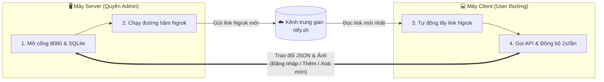

<h1 align="center">🖥️ LAB 4 – WORKING WITH WEB SERVER IN C#</h1>
<div align="center">

### TRUYỀN THÔNG VỚI WEB SERVER TRONG C#

*Bài thực hành nhóm môn Lập trình mạng căn bản – Xây dựng ứng dụng giao tiếp với Web Server, xử lý HTTP Request/Response, khai thác dữ liệu website và tích hợp Web API bằng C#.*

<a href ="https://learn.microsoft.com/vi-vn/dotnet/csharp/" target="_blank" rel="noopener noreferrer">
    
  </a>
   <a href ="https://dotnet.microsoft.com/" target="_blank" rel="noopener noreferrer">
     
  </a>
  <a href ="https://learn.microsoft.com/vi-vn/dotnet/desktop/winforms/" target="_blank" rel="noopener noreferrer">
     
  </a>
  <a href="https://www.w3schools.com/tags/ref_httpmethods.asp" target="_blank" rel="noopener noreferrer">
    
  </a>
  <a href="https://viblo.asia/p/html5-overview-jlA7GKByMKZQ" target="_blank" rel="noopener noreferrer">
    
  </a>
  <a href="https://www.json.org/json-en.html" target="_blank" rel="noopener noreferrer">
    
  </a>
  <a href="https://developer.microsoft.com/vi-vn/microsoft-edge/webview2?form=MA13LH&cs=1190118532"target="_blank" rel="noopener noreferrer">
    
  </a>
  <a href="https://blog-postman-com.translate.goog/rest-api-examples/?_x_tr_sl=en&_x_tr_tl=vi&_x_tr_hl=vi&_x_tr_pto=tc" target="_blank" rel="noopener noreferrer">
    
  </a>
  <a href ="https://git-scm.com/" target="_blank" rel="noopener noreferrer">
     
  </a>
  <a href ="https://github.com/hongmynhu18years-svg/LAB03_NT106" target="_blank" rel="noopener noreferrer">
     
  </a>
  
</div>

---

## 👥 Thông tin nhóm thực hiện

| Nội dung | Thông tin |
|---|---|
| **Môn học** | Lập trình mạng căn bản |
| **Bài thực hành** | Lab 4 – Working with Web Server in C# |
| **Nhóm** | 3 |
| **Lớp** | NT106.R14.2 |

## 🧑‍💻 Danh sách thành viên

| STT | Họ và tên | MSSV | 
|:---:|---|:---:|
| 1 | Hồng Mỹ Như | 25521342 | 
| 2 | Tô Thị Thanh Nhi | 25521332 | 
| 3 | Trương Vũ Hoàng Ngân | 25521185 | 
| 4 | Võ Thị Minh Thư | 25521816 |
| 5 | Lê Hoàn Phúc | 25521422 |

---

## 📖 Giới thiệu

**LAB 4 – Working with Web Server in C#** là bài thực hành nhóm thuộc môn **Lập trình mạng căn bản**, tập trung xây dựng các ứng dụng giao tiếp với Web Server bằng ngôn ngữ C# trên nền tảng Windows Forms.

Bài thực hành giúp sinh viên tìm hiểu cơ chế **HTTP Request/Response**, sử dụng các phương thức **GET, POST** để gửi và nhận dữ liệu, tải nội dung website, xử lý HTML và JSON, đồng thời khai thác Web API để xây dựng các ứng dụng thực tế.

Ngoài ra, Lab 04 giới thiệu cách tạo website đơn giản bằng **HTML**, triển khai Web Server cục bộ bằng **IIS (localhost)** và sử dụng **Postman** để kiểm tra API.

Các bài tập được tổ chức thành những project riêng trong cùng một solution, kết hợp giao diện Windows Forms để thực hiện các chức năng tương ứng.

<p align="center">


</p>

### 🎯 Mục tiêu thực hành

- Hiểu nguyên lý giao tiếp giữa Client và Web Server thông qua HTTP/HTTPS.
- Sử dụng `WebRequest`, `WebResponse`, `WebClient` và `HttpClient` để gửi, nhận dữ liệu.
- Thực hiện HTTP GET và POST để truy xuất thông tin và gửi dữ liệu lên Web Server.
- Xây dựng website HTML đơn giản và triển khai trên localhost bằng IIS.
- Sử dụng `WebView2` để hiển thị website trong ứng dụng Windows Forms.
- Tải nội dung HTML, trích xuất dữ liệu và tài nguyên website.
- Xử lý dữ liệu **JSON** và khai thác **REST API**.
- Tìm hiểu cơ chế xác thực bằng **JWT (JSON Web Token)**.
- Kết hợp API để xây dựng các ứng dụng quản lý và xử lý dữ liệu thực tế.
- Sử dụng **Postman** để kiểm tra các yêu cầu HTTP và phản hồi từ API.

### 📚 Nội dung thực hành

| Bài | Tên bài thực hành | Mô hình / Công nghệ |
|---|---|---|
| **01** | Hiển thị mã nguồn HTML của website | HTTP GET, `WebRequest`, `WebResponse` |
| **02** | Download nội dung website thành file HTML | `WebClient`, `DownloadFile()` |
| **03** | Xây dựng trình duyệt Web cơ bản | `WebView2`, HTML Agility Pack |
| **04** | Quản lý phòng vé – Phiên bản 4 | Web Scraping, JSON, Windows Forms |
| **07** | Hôm nay ăn gì? – Phiên bản 4 | REST API, quản lý và chọn ngẫu nhiên món ăn |

### 🛠️ Công nghệ sử dụng

- **Ngôn ngữ lập trình:** C#
- **Nền tảng:** .NET, Windows Forms
- **IDE:** Microsoft Visual Studio
- **Giao thức:** HTTP/HTTPS
- **Web Server:** IIS, localhost
- **Thư viện:** `System.Net`, `System.IO`, `System.Net.Http`
- **Web Browser:** Microsoft Edge WebView2
- **Xử lý HTML:** HTML Agility Pack
- **Định dạng dữ liệu:** HTML, JSON
- **Quản lý mã nguồn:** Git, GitHub

---

## 📄 BÀI 1 – HIỂN THỊ MÃ NGUỒN HTML (VIEW HTML SOURCE)

### 🖼️ Giao diện chương trình

**Giao diện View HTML Source**

<p align="center">


   
</p>

### 🎯 Nội dung thực hành

- Xây dựng ứng dụng **C# Windows Forms** để lấy và hiển thị mã nguồn HTML của website.
- Sử dụng **HTTP/HTTPS** và phương thức **GET** để giao tiếp với Web Server.
- Sử dụng `WebRequest`, `WebResponse`, `Stream` và `StreamReader` để gửi yêu cầu, nhận và đọc dữ liệu.
- Kiểm tra tính hợp lệ của URL và xử lý lỗi kết nối.
- Hiển thị HTML trong `RichTextBox`, hỗ trợ tự động xuống dòng và thanh cuộn dọc.

### 🛠️ Cách thức thực hiện

**1. Khởi tạo giao diện (`Bai01Form`)**

- Khởi tạo Windows Forms bằng `InitializeComponent()`.
- Sử dụng `txtURL` để nhập địa chỉ website.
- Sử dụng `btnGET` để thực hiện yêu cầu lấy HTML.
- Sử dụng `rtbHTML` để hiển thị nội dung nhận được.
- Thiết lập `WordWrap = true`, `ScrollBars = Vertical` và `ReadOnly = true` cho `rtbHTML`.

**2. Xử lý sự kiện GET (`btnGET_Click()`)**

- Khi người dùng nhấn **GET**, sự kiện `btnGET_Click()` được kích hoạt.
- Lấy URL bằng `txtURL.Text.Trim()`.
- Kiểm tra URL rỗng bằng `string.IsNullOrEmpty()`.
- Kiểm tra định dạng URL bằng `Uri.TryCreate()` và giao thức bằng `uri.Scheme`.
- Chỉ chấp nhận URL sử dụng **HTTP/HTTPS**.
- Nếu hợp lệ, gọi hàm `getHTML(url)` để lấy dữ liệu.
- Xóa nội dung cũ và hiển thị HTML mới trong `rtbHTML`.

**3. Gửi yêu cầu HTTP GET (`getHTML()`)**

- Sử dụng `WebRequest.Create(szURL)` để khởi tạo HTTP Request.
- Thiết lập `request.Timeout = 10000` để giới hạn thời gian chờ 10 giây.
- Gọi `GetResponse()` để nhận phản hồi từ Web Server.
- Sử dụng `GetResponseStream()` để lấy luồng dữ liệu.
- Sử dụng `StreamReader.ReadToEnd()` để đọc toàn bộ HTML thành chuỗi.
- Sử dụng `using` để tự động giải phóng tài nguyên sau khi xử lý.

**4. Hiển thị kết quả và xử lý lỗi**

- Gán nội dung HTML bằng `rtbHTML.Text = html`.
- Sử dụng `SelectionStart = 0` và `ScrollToCaret()` để đưa nội dung về đầu.
- Hỗ trợ xuống dòng tự động và thanh cuộn dọc.
- Sử dụng `try-catch` để xử lý các lỗi phát sinh.
- Sử dụng `WebException` để bắt lỗi liên quan đến kết nối Web Server.
- Hiển thị thông báo lỗi bằng `MessageBox.Show()`.

### 📡 Giao thức trao đổi dữ liệu

| Thành phần | Chức năng |
|---|---|
| `HTTP GET` | Yêu cầu lấy nội dung website |
| `WebRequest` | Tạo và gửi HTTP Request |
| `WebResponse` | Nhận HTTP Response |
| `StreamReader` | Đọc dữ liệu HTML |
| `RichTextBox` | Hiển thị mã nguồn HTML |

**Quy trình xử lý:**

1. Người dùng nhập URL và nhấn **GET**.
2. Chương trình kiểm tra tính hợp lệ của URL.
3. Client gửi HTTP GET Request đến Web Server.
4. Web Server xử lý yêu cầu và trả về HTTP Response.
5. Client sử dụng `StreamReader` để đọc nội dung HTML.
6. Hiển thị mã nguồn HTML lên `rtbHTML`.

**Sơ đồ hoạt động:**

```text
Người dùng
    |
    v
Nhập URL (txtURL)
    |
    v
Nhấn GET (btnGET_Click)
    |
    v
Kiểm tra URL hợp lệ
    |
    v
WebRequest -> Web Server
    |
    v
WebResponse -> StreamReader
    |
    v
Hiển thị HTML (rtbHTML)
```

### ▶️ Hướng dẫn sử dụng

1. Mở solution `Lab04` bằng Microsoft Visual Studio.
2. Chọn project `Bai01` làm **Startup Project**.
3. Nhấn `Ctrl + Shift + B` để Build Solution.
4. Nhấn `F5` để chạy chương trình.
5. Nhập URL, ví dụ `https://example.com`.
6. Nhấn **GET** để lấy nội dung HTML.
7. Xem mã nguồn trong `rtbHTML` và cuộn dọc khi cần.
8. Nhập URL mới và nhấn GET để cập nhật nội dung.

> [!NOTE]
> Chương trình hiển thị mã nguồn HTML dưới dạng văn bản, không render thành giao diện website.

---
## 📄 BÀI 2 – TẢI TRANG WEB VÀ LƯU THÀNH FILE (DOWNLOAD WEB PAGE)

### 🖼️ Giao diện chương trình

**Giao diện Tải trang web**

<p align="center">

<!-- 🖼️ CHÈN ẢNH 1: Giao diện ban đầu của Bài 2 (form "TẢI TRANG WEB" khi vừa mở, chưa tải gì) -->


</p>

### 🎯 Nội dung thực hành

- Xây dựng ứng dụng **C# Windows Forms** để tải nội dung một trang web về máy và lưu thành file `.html`.
- Sử dụng **HTTP/HTTPS** để giao tiếp với Web Server và tải dữ liệu về.
- Sử dụng `WebClient.DownloadFile()` để tải trang web và lưu trực tiếp xuống ổ đĩa.
- Sử dụng `SaveFileDialog` để người dùng chọn vị trí và tên file lưu.
- Đọc lại file đã lưu bằng `File.ReadAllText()` và hiển thị nội dung trong `RichTextBox`.
- Kiểm tra dữ liệu đầu vào và xử lý lỗi bằng `try-catch`.

### 🛠️ Cách thức thực hiện

**1. Khởi tạo giao diện (`Bai02Form`)**

- Khởi tạo Windows Forms bằng `InitializeComponent()`.
- Sử dụng `txtURL` để nhập địa chỉ trang web cần tải.
- Sử dụng `txtFilePath` để hiển thị đường dẫn file sẽ lưu.
- Sử dụng `btnBrowse` để mở hộp thoại chọn nơi lưu file.
- Sử dụng `btnDownload` để thực hiện tải trang web, `btnThoat` để đóng chương trình.
- Sử dụng `lblTrangThai` để hiển thị trạng thái xử lý (đang tải, thành công, lỗi).
- Sử dụng `rtbContent` để hiển thị nội dung HTML sau khi tải, thiết lập `ReadOnly = true`.

**2. Chọn nơi lưu file (`btnBrowse_Click()`)**

- Khi người dùng nhấn **Chọn...**, sự kiện `btnBrowse_Click()` được kích hoạt.
- Tạo `SaveFileDialog` với bộ lọc `HTML Files|*.html|All Files|*.*`.
- Đặt tên file mặc định là `uit.html`.
- Nếu người dùng chọn **OK**, gán đường dẫn đã chọn vào `txtFilePath.Text`.
- Sử dụng `using` để tự động giải phóng tài nguyên của hộp thoại.

**3. Xử lý sự kiện tải xuống (`btnDownload_Click()`)**

- Khi người dùng nhấn **Tải xuống**, sự kiện `btnDownload_Click()` được kích hoạt.
- Lấy URL và đường dẫn file bằng `Text.Trim()`.
- Kiểm tra rỗng bằng `string.IsNullOrEmpty()`, nếu thiếu thì báo lỗi màu đỏ trên `lblTrangThai`.
- Cập nhật trạng thái "Đang tải..." và gọi `Application.DoEvents()` để giao diện hiển thị ngay.
- Tạo `WebClient` và gọi `DownloadFile(url, filePath)` để tải trang web và lưu thành file.
- Đọc nội dung file vừa lưu bằng `File.ReadAllText()` và gán vào `rtbContent.Text`.
- Hiển thị "Tải thành công!" và thông báo bằng `MessageBox.Show()`.

**4. Xử lý lỗi và thoát chương trình**

- Sử dụng `try-catch` bắt mọi ngoại lệ phát sinh (URL sai, mất kết nối, không có quyền ghi file...).
- Hiển thị nội dung lỗi trên `lblTrangThai` bằng màu đỏ (`Color.Red`).
- Nút **Thoát** gọi `this.Close()` để đóng ứng dụng.

### 📡 Giao thức trao đổi dữ liệu

| Thành phần | Chức năng |
|---|---|
| `HTTP GET` | Yêu cầu lấy nội dung trang web |
| `WebClient` | Gửi HTTP Request và tải dữ liệu về máy |
| `SaveFileDialog` | Chọn vị trí và tên file lưu |
| `File.ReadAllText` | Đọc lại nội dung file đã lưu |
| `RichTextBox` | Hiển thị mã nguồn HTML đã tải |

**Quy trình xử lý:**

1. Người dùng nhập URL và chọn nơi lưu file.
2. Nhấn **Tải xuống**, chương trình kiểm tra dữ liệu đầu vào.
3. Client gửi HTTP GET Request đến Web Server.
4. Web Server trả về nội dung trang web.
5. `WebClient` ghi dữ liệu nhận được xuống file `.html`.
6. Chương trình đọc lại file và hiển thị nội dung lên `rtbContent`.

**Sơ đồ hoạt động:**

```text
Người dùng
    |
    v
Nhập URL (txtURL) + Chọn nơi lưu (btnBrowse)
    |
    v
Nhấn Tải xuống (btnDownload_Click)
    |
    v
Kiểm tra URL và đường dẫn
    |
    v
WebClient.DownloadFile -> Web Server
    |
    v
Lưu file .html xuống ổ đĩa
    |
    v
File.ReadAllText -> Hiển thị (rtbContent)
```

### ▶️ Hướng dẫn sử dụng

1. Mở solution `Lab04` bằng Microsoft Visual Studio.
2. Chọn project `Bai02` làm **Startup Project**.
3. Nhấn `Ctrl + Shift + B` để Build Solution.
4. Nhấn `F5` để chạy chương trình.
5. Nhập URL cần tải, ví dụ `https://portal.uit.edu.vn`.
6. Nhấn **Chọn...** để chọn nơi lưu file.
7. Nhấn **Tải xuống**, chờ thông báo thành công.
8. Mở file `.html` đã lưu để kiểm tra.
9. (Tuỳ chọn) Thử bỏ trống URL hoặc đường dẫn để xem thông báo lỗi.

> [!NOTE]
> Chương trình lưu trang web dưới dạng file HTML và hiển thị mã nguồn dạng văn bản, không tải kèm hình ảnh, CSS hay JavaScript của trang.

---
## 📄 BÀI 3 – TRÌNH DUYỆT WEB CƠ BẢN (BASIC WEB BROWSER)

### 🖼️ Giao diện chương trình

**Giao diện Trình duyệt Web cơ bản**

<p align="center">

<!-- 🖼️ CHÈN ẢNH 1: Giao diện tổng quan Bài 3 (có WebView đang hiển thị trang uit.edu.vn) -->


</p>

### 🎯 Nội dung thực hành

- Xây dựng ứng dụng **C# Windows Forms** mô phỏng một trình duyệt web cơ bản.
- Sử dụng điều khiển **WebView2** (`Microsoft.Web.WebView2`) để hiển thị trang web hoàn chỉnh (HTML, CSS, JavaScript, hình ảnh).
- Sử dụng `WebClient` để tải file HTML và mã nguồn trang web.
- Sử dụng thư viện **HtmlAgilityPack** để phân tích HTML và trích xuất các thẻ ``.
- Tự động tải toàn bộ hình ảnh của trang web về thư mục do người dùng chọn.
- Sử dụng `SaveFileDialog`, `FolderBrowserDialog` để chọn nơi lưu dữ liệu.
- Xử lý lỗi bằng `try-catch` và thông báo bằng `MessageBox`.

### 🛠️ Cách thức thực hiện

**1. Khởi tạo giao diện (`Bai03Form`)**

- Khởi tạo Windows Forms bằng `InitializeComponent()`.
- Sử dụng `txtURL` để nhập địa chỉ truy cập (mặc định `http://uit.edu.vn`).
- Sử dụng `webView21` (WebView2) để hiển thị trang web.
- Sử dụng 4 nút chức năng:
  - `btnLoad`: tải và hiển thị trang web.
  - `btnDownloadFiles`: tải trang web về file HTML.
  - `btnDownloadResources`: tải toàn bộ hình ảnh của trang.
  - `btnViewSource`: xem mã nguồn HTML.
- Sử dụng `btnThoat` để đóng chương trình.

**2. Khởi tạo WebView2 (`Bai03Form_Load()`)**

- Khi form được mở, sự kiện `Bai03Form_Load()` gọi `EnsureCoreWebView2Async(null)` để khởi tạo lõi trình duyệt WebView2.
- Sau khi khởi tạo xong, tự động điều hướng đến URL trong `txtURL` bằng `CoreWebView2.Navigate()`.

**3. Tải trang web (`btnLoad_Click()`)**

- Kiểm tra `txtURL` không rỗng bằng `string.IsNullOrWhiteSpace()`.
- Kiểm tra `CoreWebView2` đã sẵn sàng; nếu chưa thì hiển thị thông báo yêu cầu đợi và thử lại.
- Nếu sẵn sàng, gọi `CoreWebView2.Navigate(txtURL.Text)` để hiển thị trang web.

**4. Tải trang web về file HTML (`btnDownloadFiles_Click()`)**

- Mở `SaveFileDialog` với bộ lọc `HTML Files|*.html`, tên mặc định `page.html`.
- Sử dụng `WebClient.DownloadFile()` để tải trang web và lưu xuống đường dẫn đã chọn.
- Hiển thị thông báo thành công, hoặc thông báo lỗi nếu có ngoại lệ.

**5. Tải hình ảnh của trang web (`btnDownloadResources_Click()`)**

- Mở `FolderBrowserDialog` để chọn thư mục lưu hình ảnh.
- Dùng `WebClient.DownloadString()` để lấy toàn bộ mã HTML của trang.
- Dùng `HtmlAgilityPack.HtmlDocument.LoadHtml()` để phân tích HTML, và `SelectNodes("//img")` để lấy tất cả thẻ ``.
- Với mỗi thẻ ``:
  - Lấy giá trị thuộc tính `src` bằng `GetAttributeValue()`.
  - Ghép với địa chỉ gốc bằng `new Uri(baseUri, src)` để xử lý cả đường dẫn tương đối.
  - Lấy tên file bằng `Path.GetFileName()` và tạo đường dẫn lưu bằng `Path.Combine()`.
  - Tải ảnh bằng `DownloadFile()`, bỏ qua ảnh lỗi bằng `try-catch` lồng bên trong.
- Thông báo số lượng hình ảnh đã tải thành công; nếu trang không có ảnh thì hiển thị "Không tìm thấy hình ảnh nào!".

**6. Xem mã nguồn (`btnViewSource_Click()`)**

- Dùng `WebClient.DownloadString()` để lấy mã HTML của trang.
- Tạo một `Form` mới kích thước 800x600 chứa `RichTextBox` (`Dock = Fill`, font `Consolas`).
- Hiển thị bằng `ShowDialog()`.

### 📡 Giao thức trao đổi dữ liệu

| Thành phần | Chức năng |
|---|---|
| `HTTP/HTTPS GET` | Yêu cầu lấy nội dung trang web và tài nguyên |
| `WebView2` | Hiển thị (render) trang web hoàn chỉnh |
| `WebClient` | Tải file HTML, mã nguồn và hình ảnh |
| `HtmlAgilityPack` | Phân tích HTML, trích xuất thẻ `` |
| `SaveFileDialog` | Chọn nơi lưu file HTML |
| `FolderBrowserDialog` | Chọn thư mục lưu hình ảnh |
| `RichTextBox` | Hiển thị mã nguồn HTML |

**Quy trình xử lý:**

1. Người dùng nhập URL; WebView2 hiển thị trang web.
2. Người dùng chọn chức năng: tải HTML, tải ảnh hoặc xem mã nguồn.
3. Client gửi HTTP GET Request đến Web Server.
4. Web Server trả về HTML hoặc tài nguyên được yêu cầu.
5. Chương trình xử lý dữ liệu (lưu file, phân tích thẻ ``, hiển thị mã nguồn).
6. Thông báo kết quả cho người dùng.

**Sơ đồ hoạt động:**

```text
Người dùng
    |
    v
Nhập URL (txtURL)
    |
    +--> Load -------------> WebView2.Navigate -> Hiển thị trang web
    |
    +--> Tải HTML ---------> WebClient.DownloadFile -> Lưu file .html
    |
    +--> Tải Ảnh ----------> WebClient.DownloadString
    |                              |
    |                              v
    |                        HtmlAgilityPack: SelectNodes("//img")
    |                              |
    |                              v
    |                        DownloadFile từng ảnh -> Thư mục đã chọn
    |
    +--> Xem Code ---------> WebClient.DownloadString -> Form mới (RichTextBox)
```

### ▶️ Hướng dẫn sử dụng

1. Mở solution `Lab04` bằng Microsoft Visual Studio.
2. Chọn project `Bai03` làm **Startup Project**.
3. Cài các gói NuGet nếu chưa có: `Microsoft.Web.WebView2` và `HtmlAgilityPack` (Restore NuGet Packages).
4. Máy cần có **WebView2 Runtime** (đã có sẵn trên Windows 10/11 có Edge).
5. Nhấn `Ctrl + Shift + B` để Build Solution, rồi `F5` để chạy.
6. Nhập URL (ví dụ `https://portal.uit.edu.vn`) và nhấn **Tải trang (Load)**.
7. Nhấn **Tải HTML**, chọn nơi lưu file.
8. Nhấn **Tải Ảnh**, chọn thư mục lưu hình ảnh.
9. Nhấn **Xem Code** để xem mã nguồn HTML.

> [!NOTE]
> - Chương trình dùng **WebView2** nên trang web được hiển thị đầy đủ như trình duyệt thật (khác với Bài 1 chỉ hiển thị mã nguồn dạng văn bản).
> - Chức năng **Tải Ảnh** chỉ tải các ảnh nằm trong thẻ ``; ảnh nền CSS hoặc ảnh tải động bằng JavaScript sẽ không được tải.

---
## 📄 BÀI 4 – HỆ THỐNG ĐẶT VÉ XEM PHIM (CINEMA BOOKING – CLIENT/SERVER)

### 🖼️ Giao diện chương trình

**Giao diện chính – Nhập tên khách hàng**

<p align="center">

<!-- 🖼️ CHÈN ẢNH 1: Form chính (Lab04_Bai04) với ô nhập tên khách hàng và nút "Chọn phim đang chiếu (Beta Cinemas)" -->


</p>

**Giao diện Danh sách phim và Đặt vé**

<p align="center">

<!-- 🖼️ CHÈN ẢNH 2: Form "Phim đang chiếu - Beta Cinemas" hiển thị danh sách phim (poster, tên, link, mô tả, nút Đặt vé) -->


<!-- 🖼️ CHÈN ẢNH 3: Form Booking (sơ đồ ghế, chọn phòng chiếu, tổng tiền) -->


</p>

**Giao diện Quản trị (Admin)**

<p align="center">

<!-- 🖼️ CHÈN ẢNH 4: Form Admin sau khi bấm "Xuất thống kê" (ListView thống kê doanh thu + ProgressBar) -->


</p>

### 🎯 Nội dung thực hành

- Xây dựng ứng dụng **C# Windows Forms** mô phỏng hệ thống đặt vé xem phim theo mô hình **Client – Server**.
- Sử dụng **TCP Socket** (`TcpListener`, `TcpClient`) để Server và nhiều Client trao đổi dữ liệu theo thời gian thực.
- Server quản lý trạng thái ghế của từng phim theo từng phòng chiếu, xử lý **tranh chấp đặt ghế** khi nhiều Client cùng đặt.
- Sử dụng **đa luồng** (`Thread`) để Server phục vụ nhiều Client và Client lắng nghe thông báo từ Server.
- Lấy danh sách phim đang chiếu từ website **Beta Cinemas** bằng `HttpClient` và `Regex`, lưu/đọc dữ liệu dạng **JSON** (`System.Text.Json`).
- Hiển thị trang chi tiết phim bằng **WebView2**.
- Tính tiền vé theo hệ số giá của từng loại ghế, xuất hóa đơn và ghi dữ liệu bán vé ra file `input5.txt`.
- Form quản trị (có mật khẩu) thống kê doanh thu, xếp hạng phim và ghi báo cáo ra file `output5.txt`.
- Xây dựng giao diện tùy biến: form không viền, ảnh nền GIF động, kéo thả form bằng `user32.dll`.

### 🛠️ Cách thức thực hiện

**1. Cấu trúc project**

| File | Chức năng |
|---|---|
| `Program.cs` | Điểm khởi chạy, khởi động Server (nếu là máy chủ) rồi mở form chính |
| `Bai04.cs` (`Lab04_Bai04`) | Form chính: nhập tên khách hàng, chọn phim, vào khu vực Admin |
| `Lab04_Bai04_DanhSachPhim.cs` | Form danh sách phim, lấy dữ liệu từ website, xem chi tiết phim (WebView2) |
| `Lab04_Bai04_PhimOnline.cs` | Model `PhimOnline` và lớp `PhimScraper` (lấy dữ liệu web, đọc/ghi JSON) |
| `Lab04_Bai04_BookingForm.cs` | Form đặt vé (Client): chọn ghế, thanh toán, nhận cập nhật từ Server |
| `Lab04_Bai04_Server.cs` | Server TCP: quản lý ghế, xử lý đặt vé, thông báo cập nhật cho mọi Client |
| `Lab04_Bai04_PasswordForm.cs` | Form nhập mật khẩu Admin |
| `Lab04_Bai04_AdminForm.cs` | Form thống kê doanh thu, xếp hạng, ghi file kết quả |
| `Lab04_Bai04_ThongKePhim.cs` | Model dữ liệu thống kê phim |

**2. Khởi động chương trình (`Program.cs`)**

- Gọi `ApplicationConfiguration.Initialize()`.
- Đọc địa chỉ Server từ file `serverip.txt` cạnh file `.exe`; nếu không có file thì dùng `127.0.0.1` (máy này vừa là Server vừa là Client).
- Nếu là máy chủ (`LaMayChu`), gọi `Lab04_Bai04_Server.StartServer()` để mở Server tại cổng **9090**.
- Hiển thị hộp thoại chẩn đoán Server (bật/tắt bằng hằng số `HIEN_CHAN_DOAN`).
- Chạy form chính `Lab04_Bai04`.

**3. Form chính (`Lab04_Bai04`)**

- Hiển thị ảnh nền **GIF động**; dùng `Timer` (80ms) và `SelectActiveFrame()` để chuyển từng khung hình.
- Người dùng nhập tên khách hàng trong `txtCustomerName`; nếu để trống sẽ báo lỗi đỏ trên `lblThongBao`.
- Nút **🌐 Chọn phim đang chiếu (Beta Cinemas)** được tạo bằng code, mở `Lab04_Bai04_DanhSachPhim` kèm tên khách hàng.
- Liên kết Admin mở `Lab04_Bai04_PasswordForm`; nhập đúng mật khẩu sẽ mở `Lab04_Bai04_AdminForm`.
- Hỗ trợ kéo form bằng chuột qua `ReleaseCapture()` và `SendMessage()` (gọi `user32.dll`), cùng các nút thu nhỏ, phóng to, đóng.

**4. Lấy danh sách phim từ website (`PhimScraper`)**

- Dùng `HttpClient` gửi HTTP GET đến `https://betacinemas.vn/phim.htm` (cấu hình `User-Agent`, `Accept-Language`, timeout 30 giây).
- Dùng `Regex` tách từng khối `film-item` trong HTML để lấy: tên phim, link chi tiết, ảnh poster, thể loại và thời lượng.
- Truy cập từng trang chi tiết để lấy mô tả từ thẻ meta `og:description`; `ProgressBar` chạy theo tiến độ từng phim (`IProgress<int>`).
- Nếu không tách được phim nào, tự động ghi file `debug_phim.html` để kiểm tra lại cấu trúc trang.
- Lưu danh sách vào `phim.json` bằng `JsonSerializer` (giữ nguyên tiếng Việt có dấu); lần mở sau đọc từ file này nếu có sẵn.

**5. Form danh sách phim (`Lab04_Bai04_DanhSachPhim`)**

- Form được tạo hoàn toàn bằng code, dùng `FlowLayoutPanel` hiển thị mỗi phim thành một mục (poster, tên, link, mô tả, nút **Đặt vé**).
- Khi mở form, đọc dữ liệu từ `phim.json`; nút **Lấy dữ liệu từ website** gọi `PhimScraper.LayDanhSachAsync()` bất đồng bộ (`async/await`) để không làm treo giao diện.
- Nhấn vào poster, tên, link hoặc mô tả sẽ mở form `Lab04_Bai04_ChiTietPhim` dùng **WebView2** hiển thị trang chi tiết (tự động ẩn popup chọn tỉnh/rạp bằng JavaScript).
- Nhấn **Đặt vé** mở `Lab04_Bai04_BookingForm`.

**6. Server (`Lab04_Bai04_Server`)**

- Dùng `TcpListener` lắng nghe tại `IPAddress.Any`, cổng `9090`; mỗi Client được phục vụ trên một `Thread` riêng.
- Lưu ghế đã đặt trong `Dictionary<string, HashSet<string>>` với khóa là `tên phim_phòng chiếu`; dùng `lock` để đảm bảo an toàn đa luồng.
- Dữ liệu ghế được lưu bền vững vào file `Lab03_Bai04_Seats.txt` (mỗi dòng dạng `movieKey|A1,A2,...`) và nạp lại khi Server khởi động.
- Xử lý các lệnh từ Client:

| Lệnh Client gửi | Ý nghĩa | Phản hồi của Server |
|---|---|---|
| `GET_SEATS\|movieKey` | Lấy danh sách ghế đã đặt của một suất | `SEATS\|movieKey\|A1,A2,...` |
| `GET_ALL` | Lấy toàn bộ dữ liệu ghế | `ALL_DATA\|...` |
| `BOOK\|movieKey\|A1,B2,...` | Đặt các ghế đã chọn | `SUCCESS\|...` hoặc `FAILED\|...` |

- Khi đặt vé thành công, Server **broadcast** `SEAT_UPDATED|movieKey|...` đến tất cả Client để cập nhật sơ đồ ghế ngay lập tức.
- Nếu một ghế trong danh sách đã có người đặt, Server từ chối toàn bộ yêu cầu (`FAILED`) để tránh đặt trùng.

**7. Form đặt vé – Client (`Lab04_Bai04_BookingForm`)**

- Khi mở form, Client kết nối Server bằng `TcpClient` (thử lại tối đa 10 lần), sau đó tạo một luồng riêng (`ListenFromServer`) để nhận thông báo liên tục.
- Chọn **phòng chiếu** bằng `cbPhongChieu`; mỗi lần đổi phòng, Client gửi `GET_SEATS` để tải lại trạng thái ghế.
- Sơ đồ ghế gồm 15 ghế (hàng A, B, C – mỗi hàng 5 ghế) với 3 trạng thái màu:
  - Màu mặc định: ghế trống.
  - Màu xanh lá (`Green`): ghế đang chọn.
  - Màu đỏ (`Red`): ghế đã có người đặt (bị vô hiệu hóa).
- Tính tiền theo hệ số giá:

| Ghế | Hệ số giá |
|---|---|
| `A1`, `A5`, `C1`, `C5` | 0.25 × giá chuẩn |
| `B2`, `B3`, `B4` | 2.0 × giá chuẩn |
| Các ghế còn lại | 1.0 × giá chuẩn |

- Nhấn **Thanh toán**: Client gửi lệnh `BOOK`, đồng thời chờ phản hồi tối đa 3 giây (báo lỗi nếu Server không phản hồi).
  - `SUCCESS`: hiển thị hóa đơn trong `rtbHoaDon`, ghi dữ liệu vào `input5.txt`, khóa các ghế vừa đặt.
  - `FAILED`: báo cảnh báo tranh chấp ghế và tải lại trạng thái ghế.
- Khi Client khác đặt vé, thông điệp `SEAT_UPDATED` từ Server giúp sơ đồ ghế cập nhật ngay; nếu ghế đang chọn bị người khác đặt trước, chương trình báo "Ghế bạn chọn vừa có người khác đặt!".
- Cập nhật giao diện từ luồng nền bằng `Invoke()` (hàm `RunOnUI`).

**8. Ghi dữ liệu bán vé (`input5.txt`)**

- Mỗi phim/phòng lưu thành 5 dòng liên tiếp: tên phim, giá vé chuẩn, phòng chiếu, tổng số vé (mặc định 15), số vé đã bán.
- Khi thanh toán thành công, chương trình cộng thêm số vé vừa đặt vào đúng phim và phòng, hoặc tạo mục mới nếu chưa có.

**9. Form quản trị (`PasswordForm` và `AdminForm`)**

- `PasswordForm`: ô nhập mật khẩu ẩn ký tự (`PasswordChar = '*'`), kiểm tra mật khẩu, báo lỗi nếu bỏ trống hoặc sai.
- `AdminForm` – nút **Xuất thống kê**:
  - Đọc file `input5.txt`, kiểm tra tồn tại và dữ liệu hợp lệ.
  - Tính các chỉ tiêu: số vé tồn, tỉ lệ bán ra (%), doanh thu = số vé bán × giá chuẩn.
  - Sắp xếp theo doanh thu giảm dần bằng LINQ (`OrderByDescending`) và đánh số **xếp hạng**.
  - Hiển thị kết quả trong `ListView` (chế độ `Details`, có lưới), `ProgressBar` thể hiện tiến độ xử lý.
- `AdminForm` – nút **Ghi File**: dùng `SaveFileDialog` và `StreamWriter` (UTF-8) ghi bảng thống kê ra file `output5.txt`.

### 📡 Giao thức trao đổi dữ liệu

| Thành phần | Chức năng |
|---|---|
| `TCP Socket` (`TcpListener`, `TcpClient`) | Truyền dữ liệu đặt vé giữa Client và Server |
| `StreamReader` / `StreamWriter` | Gửi/nhận thông điệp dạng văn bản, mỗi dòng một lệnh, phân tách bằng ký tự `\|` |
| `Thread` | Server phục vụ nhiều Client, Client lắng nghe Server |
| `HttpClient` | Lấy danh sách phim từ website Beta Cinemas |
| `Regex` | Phân tích HTML để trích xuất thông tin phim |
| `System.Text.Json` | Lưu/đọc danh sách phim (`phim.json`) |
| `WebView2` | Hiển thị trang chi tiết phim |
| File văn bản | `Lab03_Bai04_Seats.txt` (ghế), `input5.txt` (bán vé), `output5.txt` (báo cáo) |

**Quy trình xử lý:**

1. Chương trình khởi động, máy chủ mở Server cổng 9090.
2. Người dùng nhập tên khách hàng, mở danh sách phim (lấy từ website hoặc từ `phim.json`).
3. Chọn phim, chọn phòng chiếu; Client kết nối Server và tải trạng thái ghế.
4. Chọn ghế, nhấn **Thanh toán** → Client gửi lệnh `BOOK`.
5. Server kiểm tra ghế còn trống, cập nhật dữ liệu rồi trả `SUCCESS`/`FAILED`.
6. Server broadcast `SEAT_UPDATED` đến mọi Client đang kết nối.
7. Client hiển thị hóa đơn, ghi `input5.txt`; Admin thống kê và xuất `output5.txt`.

**Sơ đồ hoạt động:**

```text
Client 1                        Server (TCP :9090)                      Client 2
   |                                   |                                    |
   |-- GET_SEATS|phim_phòng ---------->|                                    |
   |<-- SEATS|phim_phòng|A1,A2 --------|                                    |
   |                                   |<------- GET_SEATS|phim_phòng ------|
   |                                   |-------- SEATS|phim_phòng|A1,A2 --->|
   |                                   |                                    |
   |-- BOOK|phim_phòng|B2,B3 --------->|                                    |
   |                                   |  Kiểm tra ghế còn trống            |
   |                                   |  Lưu Lab03_Bai04_Seats.txt         |
   |<-- SUCCESS|Đặt vé thành công! ----|                                    |
   |<-- SEAT_UPDATED|...|A1,A2,B2,B3 --|-- SEAT_UPDATED|...|A1,A2,B2,B3 -->|
   |                                   |                                    |
   |  Ghi input5.txt, hiện hóa đơn     |      Cập nhật sơ đồ ghế (ghế đỏ)   |
   |                                   |                                    |
   |-- BOOK|phim_phòng|B2 (đã có) ---->|  (từ Client khác)                  |
   |<-- FAILED|Ghế đã có người đặt ----|                                    |
```

### ▶️ Hướng dẫn sử dụng

1. Mở solution `Lab04` bằng Microsoft Visual Studio.
2. Chọn project `Bai04` làm **Startup Project**.
3. Restore các gói NuGet nếu chưa có: `Microsoft.Web.WebView2`, `System.Data.SQLite`, `SQLitePCLRaw.bundle_e_sqlite3`.
4. Nhấn `Ctrl + Shift + B` để Build Solution, rồi `F5` để chạy.
5. **Chế độ 1 máy** (Server và Client cùng một máy): không cần cấu hình, mặc định dùng `127.0.0.1`.
6. **Chế độ nhiều máy**: trên các máy Client, tạo file `serverip.txt` cạnh file `.exe`, ghi địa chỉ IP của máy chủ; trên máy chủ mở cổng **9090** trong tường lửa.
7. Nhập **tên khách hàng** ở form chính.
8. Nhấn **Chọn phim đang chiếu (Beta Cinemas)**, nhấn **Lấy dữ liệu từ website** để tải danh sách phim.
9. (Tuỳ chọn) Nhấn vào poster/tên phim để xem trang chi tiết.
10. Nhấn **Đặt vé** ở phim muốn xem, chọn **phòng chiếu** và các **ghế**.
11. Nhấn **Thanh toán** để đặt vé.
12. Mở thêm một Client khác (máy khác hoặc chạy thêm một bản) để thử **tranh chấp ghế** và **đồng bộ thời gian thực**.
13. Quay lại form chính, nhấn liên kết **Admin**, nhập mật khẩu.
14. Nhấn **Xuất thống kê** để xem doanh thu, rồi **Ghi File** để lưu `output5.txt`.

> [!NOTE]
> - Server chỉ chạy trên máy có `serverip.txt` trống hoặc ghi `127.0.0.1`; các máy Client khác phải trỏ đúng IP của máy chủ.
> - Dữ liệu phim phụ thuộc cấu trúc HTML của website Beta Cinemas; nếu website thay đổi, cần cập nhật lại hàm `TachPhim()`.
> - Mỗi phòng chiếu có 15 ghế; trạng thái ghế được lưu trong `Lab03_Bai04_Seats.txt` nên vẫn giữ nguyên khi khởi động lại Server.
---

# 🍱Bài 7: Hôm Nay Ăn Gì? 

Ứng dụng desktop Windows Forms (C# / .NET) quản lý, đóng góp và gợi ý món ăn ngẫu nhiên theo mô hình **Client – Server phân tán qua Internet**, tích hợp RESTful API Server nhúng (`HttpListener`), cơ sở dữ liệu **SQLite**, đường hầm công khai **Ngrok** và kênh đồng bộ địa chỉ tự động **ntfy.sh**.

---

## 1. Giao diện chương trình

Ứng dụng được thiết kế theo phong cách minh họa ấm áp với 4 màn hình chức năng chính:

* **Màn hình chính (`HomNayAnGi`):**
  * **Khu vực trên:** Tiêu đề *HÔM NAY ĂN GÌ?*, nút chọn món ngẫu nhiên (**Ăn gì giờ?**) và nút mở form thêm món (**Thêm món ăn**).
  * **Khu vực giữa (`TabControl`):** Chia thành 2 tab **All** (toàn bộ món ăn trong hệ thống) và **Tôi đóng góp** (danh sách món ăn do tài khoản đang đăng nhập thêm vào). Mỗi món được hiển thị dưới dạng thẻ `MonAnCard` gồm hình ảnh, tên món, giá tiền, người đóng góp và nút **Xoá**.
  * **Khu vực dưới:** Liên kết **Login / Logout**, nhãn trạng thái xác thực (`Unauthenticated` hoặc `Welcome, <Tên>`), thanh tiến trình tải dữ liệu và hộp chọn số trang (**Page**).
    
<p align="center">

</p>

  * **Màn hình Đăng nhập (`LoginForm`):** Nhập `Username`, `Password`, hộp kiểm *Hiện mật khẩu*, nút **Login** và liên kết **Sign up** để chuyển sang giao diện đăng ký.
    
<p align="center">

</p>

  * **Màn hình Đăng ký tài khoản (`SignupForm`):** Nhập thông tin tài khoản (`Username`, `Password`) và thông tin cá nhân (`First name`, `Last name`, `Email`, `Phone`, `Birth`, `Languages`, `Sex`) kèm nút **Clear** và **Submit**.
    
<p align="center">

</p>

  * **Màn hình Món ăn ngẫu nhiên (`RandomMonAn`):** Cửa sổ bật lên hiển thị tên món ăn được hệ thống chọn ngẫu nhiên (ví dụ: *Ăn Hủ tiếu đi!!!!*) cùng hình ảnh minh họa của món đó.
    
<p align="center">

</p>

---

## 2. Nội dung thực hành

* **Xây dựng ứng dụng mạng theo kiến trúc Client – Server:** Tách biệt hoàn toàn tầng giao diện người dùng (WinForms Client) và tầng xử lý nghiệp vụ, lưu trữ dữ liệu (Embedded RESTful API Server + SQLite).
* **Lập trình giao tiếp HTTP & RESTful API:** Sử dụng `HttpListener` ở phía Server và `HttpClient` ở phía Client để trao đổi dữ liệu định dạng **JSON** qua các phương thức `GET`, `POST`, `DELETE`.
* **Xác thực & Phân quyền người dùng:** Cài đặt cơ chế băm mật khẩu bằng **SHA-256**, cấp phát và kiểm tra phiên làm việc bằng **Bearer Token** trong HTTP Header.
* **Triển khai đường hầm công khai & Đồng bộ động:** Kết hợp `ngrok` để mở cổng dịch vụ `localhost:8080` ra Internet và sử dụng dịch vụ `ntfy.sh` làm kênh báo hiệu (signaling) giúp các máy Client tự động tìm thấy Server mới mà không cần IP tĩnh.
* **Cập nhật dữ liệu thời gian thực (Real-time Sync):** Sử dụng cơ chế đánh dấu phiên bản dữ liệu (`DataVersion`) và bộ định thời (`Timer`) quét mỗi 2 giây để tự động làm mới giao diện giữa các máy.

---

## 3. Cách thức thực hiện

### 3.1. Cài đặt Ngrok (Thực hiện trên máy sẽ đóng vai trò Server)

Mở **Command Prompt (CMD)** và chạy các lệnh sau:

```cmd
# Cài đặt Ngrok bản mới nhất
winget install --id Ngrok.Ngrok

# (Nếu đã cài bản cũ, chạy lệnh cập nhật)
ngrok update

# Kiểm tra phiên bản (yêu cầu >= 3.30.0 để tránh lỗi ERR_NGROK_121)
ngrok version

# Nạp Authtoken từ tài khoản Ngrok của bạn
ngrok config add-authtoken <CHUOI_AUTHTOKEN_CUA_BAN>
```
> [!NOTE]
> Sau khi cài đặt Ngrok lần đầu, hãy khởi động lại Visual Studio hoặc máy tính để Windows nhận biến môi trường `ngrok`.

### 3.2. Khởi chạy chế độ SERVER (Máy chủ)

> [!IMPORTANT]
> Tại một thời điểm chỉ nên có **1 máy** chạy chế độ Server (nếu dùng chung 1 Authtoken Ngrok miễn phí, bật 2 máy cùng lúc sẽ bị Ngrok ngắt phiên với lỗi `ERR_NGROK_108`).

1. Tắt ứng dụng Server trên máy cũ (nếu trước đó có máy khác đang làm Server).
2. Chuột phải vào **Visual Studio 2022** (hoặc file `Lab04_Bai07.exe` trong thư mục `bin\Debug\net8.0-windows\`) → chọn **Run as administrator**.
3. Mở solution và nhấn **`F5`** để chạy.
4. Chờ **5–8 giây** để Server tự khởi tạo cơ sở dữ liệu `homnayangi.db`, lắng nghe tại `http://localhost:8080/`, mở đường hầm Ngrok và đẩy URL mới lên kênh:

```text
[https://ntfy.sh/uit-nt106-lab04-nhom-mthu-2026](https://ntfy.sh/uit-nt106-lab04-nhom-mthu-2026)
```

### 3.3. Khởi chạy chế độ CLIENT (Máy khách)

1. Kéo mã nguồn mới nhất (`git pull`) và Build solution (`Ctrl + Shift + B`).
2. Mở Visual Studio ở **chế độ bình thường** (hoặc nhấp đúp mở trực tiếp file `Lab04_Bai07.exe` — **tuyệt đối không** chọn *Run as administrator*).
3. Ứng dụng tự động đọc URL Ngrok mới nhất từ `ntfy.sh` và tải danh sách món ăn về giao diện.

### 3.4. Chuyển quyền Server sang máy thành viên khác

1. **Máy Server cũ:** Đóng hoàn toàn ứng dụng `Lab04_Bai07` (và đảm bảo tiến trình `ngrok.exe` đã tắt). *(Tùy chọn: copy file `homnayangi.db` và thư mục `images/` gửi sang máy mới nếu muốn giữ lại toàn bộ dữ liệu cũ).*
2. **Máy Server mới:** Cài Ngrok `>= 3.30.0`, nạp Authtoken → chạy ứng dụng bằng quyền **Run as administrator**.
3. **Các máy Client (kể cả máy Server cũ):** Chạy ứng dụng ở chế độ **người dùng thường**, hệ thống tự động kết nối tới máy Server mới mà không cần sửa code.

---

## 4. Giao thức trao đổi dữ liệu

* **Giao thức truyền tải:** `HTTP/1.1` qua đường hầm bảo mật `HTTPS` của Ngrok (`ngrok-skip-browser-warning: true`).
* **Định dạng dữ liệu:** `application/json; charset=utf-8` (hình ảnh tải lên được mã hóa sang chuỗi **Base64** trong payload JSON, sau đó Server giải mã lưu thành tệp ảnh vật lý và phục vụ qua HTTP GET).
* **Cơ chế xác thực:** Gửi kèm Header `Authorization: Bearer <token>` đối với các API yêu cầu đăng nhập.

### Danh sách các API Endpoint chính

| Phương thức | Endpoint | Xác thực | Mô tả chức năng & Dữ liệu trao đổi |
| :--- | :--- | :--- | :--- |
| `POST` | `/api/auth/signup` | Không | Nhận JSON thông tin đăng ký (`Username`, `Password`, `Email`, `Phone`,...), kiểm tra Regex và lưu mật khẩu băm SHA-256 vào SQLite. |
| `POST` | `/api/auth/login` | Không | Xác thực tài khoản, trả về `Token` phiên làm việc, đồng thời trích xuất IP (`X-Forwarded-For`) để thông báo lên màn hình Server. |
| `GET` | `/api/monan/all?page={p}&pageSize={s}` | Không | Trả về JSON danh sách món ăn phân trang (`Data`, `TotalPages`, `TotalItems`). |
| `GET` | `/api/monan/mine?page={p}&pageSize={s}` | Bearer Token | Trả về JSON danh sách món ăn do chính người dùng hiện tại đóng góp. |
| `GET` | `/api/monan/random?onlyMine={bool}` | Tùy chọn | Chọn ngẫu nhiên 1 món ăn (`ORDER BY RANDOM() LIMIT 1`) từ toàn bộ danh sách hoặc danh sách cá nhân. |
| `POST` | `/api/monan` | Bearer Token | Nhận JSON món ăn mới kèm ảnh Base64, lưu tệp ảnh vào `images/`, thêm bản ghi vào SQLite và tăng `DataVersion`. |
| `DELETE` | `/api/monan/{id}` | Bearer Token | Xóa món ăn theo `Id` khỏi cơ sở dữ liệu và tăng `DataVersion`. |
| `GET` | `/api/version` | Không | Trả về dấu thời gian phiên bản dữ liệu hiện tại (`DataVersion`) để Client kiểm tra thay đổi mỗi 2 giây. |
| `GET` | `/images/{filename}` | Không | Trả về luồng dữ liệu nhị phân (`image/jpeg`, `image/png`) của ảnh món ăn lưu trên Server. |

---

## 5. Sơ đồ hoạt động


---

## 6. Hướng dẫn sử dụng

1. **Xem danh sách món ăn:**
   * Mở ứng dụng ở tab **All** để xem toàn bộ món ăn hiện có trong cơ sở dữ liệu.
   * Sử dụng hộp chọn **Page** ở góc dưới bên phải để chuyển trang (mỗi trang hiển thị 5 món ăn).
2. **Đăng ký & Đăng nhập tài khoản:**
   * Bấm liên kết **Login** ở góc dưới bên trái → chọn **Sign up** nếu chưa có tài khoản.
   * Nhập đầy đủ thông tin (Email đúng định dạng `ten@domain.com`, Số điện thoại Việt Nam đủ 10 chữ số) và bấm **Submit**.
   * Quay lại form đăng nhập, nhập `Username` và `Password` → bấm **Login**. Trạng thái góc dưới chuyển sang `Welcome, <Tên>`.
3. **Thêm & Xóa món ăn:**
   * Sau khi đăng nhập, bấm nút **Thêm món ăn**, điền tên món, giá tiền, địa chỉ, mô tả và chọn hình ảnh từ máy tính để lưu.
   * Món ăn mới sẽ tự động đồng bộ sang màn hình của tất cả thành viên khác trong vòng **2 giây**.
   * Chọn tab **Tôi đóng góp** để xem các món của riêng bạn, hoặc bấm nút **Xoá** trên thẻ món ăn để gỡ bỏ.
4. **Gợi ý món ăn ngẫu nhiên:**
   * Chọn tab **All** (gợi ý trong tất cả món) hoặc tab **Tôi đóng góp** (gợi ý trong danh sách cá nhân) → bấm nút **Ăn gì giờ?** để ứng dụng chọn ngẫu nhiên một món ăn.

---

## 7. Xử lý sự cố thường gặp

| Lỗi / Hiện tượng | Nguyên nhân | Cách khắc phục |
| :--- | :--- | :--- |
| Client báo lỗi `'T' is an invalid start of a value` | Server chưa chạy hoặc đường hầm Ngrok trên Server chưa sẵn sàng nên trả về trang HTML báo offline | Kiểm tra máy Server đã chạy bằng quyền **Administrator** chưa; mở `https://ntfy.sh/uit-nt106-lab04-nhom-mthu-2026` xem đã có link mới chưa. |
| `ERR_NGROK_121` | Phiên bản Ngrok Agent trên máy quá cũ (`< 3.30.0`) | Mở CMD chạy `ngrok update` hoặc `winget upgrade --id Ngrok.Ngrok`. |
| `ERR_NGROK_108` | Có từ 2 máy trở lên bật Server cùng lúc bằng chung 1 Authtoken Ngrok miễn phí | Tắt ứng dụng và mở Task Manager kết thúc tiến trình `ngrok.exe` trên máy Server cũ trước khi bật máy mới. |
| Client không nhận chế độ Client mà tự mở Server cục bộ | Người dùng mở Visual Studio hoặc file `.exe` bằng quyền Administrator | Đóng ứng dụng và mở lại bằng cách nhấp đúp chuột trái bình thường (không chọn *Run as administrator*). |
| Lỗi cảnh báo định dạng khi đăng ký tài khoản | Nhập sai cấu trúc Email hoặc số điện thoại không đúng 10 chữ số đầu số Việt Nam (`03, 05, 07, 08, 09`) | Nhập lại Email hợp lệ (ví dụ: `ten@gmail.com`) và số điện thoại đủ 10 số. |

---
<p align="center">
  <b> LAB 4 – WORKING WITH WEB SERVER IN C#</b>
  <br>
  <em> NHÓM 3 </em>
</p>
